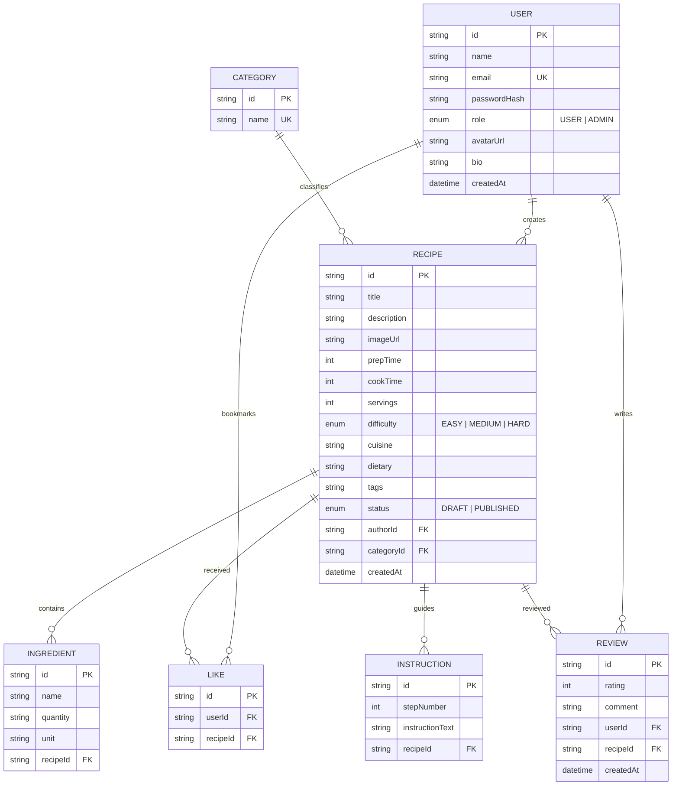

# 🍳 Culinaria — Enterprise Recipe Management System

[](https://www.typescriptlang.org/)
[](https://react.dev/)
[](https://nodejs.org/)
[](https://expressjs.com/)
[](https://www.prisma.io/)
[](https://tailwindcss.com/)

An end-to-end, production-style **Recipe Management & Culinary Discovery System** built using Node.js, Express, TypeScript, Prisma ORM, and React 19. Designed for college major project submission, resume showcases, and placement technical interviews.

---

## 🌟 Key Functional Modules

### 1. 🍳 Core Recipe Lifecycle Management (CRUD)
- **Create Recipe**: Comprehensive form for title, cover image URL, prep time, cook time, servings, difficulty (`EASY`, `MEDIUM`, `HARD`), cuisine, dietary info, tags, category, structured ingredients (name, quantity, unit), step-by-step cooking instructions, and rich description (via Tiptap).
- **Read & Detail View**: Gourmet recipe view with cover image header, quick metrics bar, author card, interactive ingredient checklist, numbered step-by-step instructions, and community rating score.
- **Update & Delete**: Safe deletion with custom confirmation modals and transaction-safe cleanup across dependent tables.

### 2. 🔍 Advanced Discovery, Filtering & Sorting
- **Multi-faceted Filtering**: Filter recipes by Category, Cuisine, Difficulty Level, Dietary preference (e.g. Vegetarian, Gluten-Free), and Maximum Prep Time limit slider.
- **Dynamic Sorting**: Sort by `Latest Published`, `Most Popular (Likes)`, `Highest Rated`, `Fastest to Cook`, and `Oldest`.
- **Instant Search**: URL-synced search with keyword matching across recipe titles, descriptions, ingredients, tags, and categories.

### 3. ⭐ Community Ratings & Reviews System
- **5-Star Rating & Review Form**: Authenticated users can post ratings (1-5 stars) and detailed comments on recipes.
- **Average Rating Calculation**: Server-side aggregation computes average rating and total review counts per recipe.
- **Review Ownership**: Users can delete their own reviews, while Admins have platform-wide moderation privileges.

### 4. 🛡️ Role-Based Authorization & Admin Dashboard
- **Role Control**: Two-tier role enforcement (`USER` and `ADMIN`).
- **Telemetry Cards**: High-level platform statistics: Total Users, Total Recipes, Total Categories, Total Reviews, Total Saved Favorites.
- **User Management**: View user profiles, toggle roles (`USER` <-> `ADMIN`), and safely delete accounts.
- **Content Moderation**: Manage all platform recipes and add/remove recipe categories.

### 5. ❤️ User Favorites & Profile Management
- **Bookmark Recipes**: One-click favorite toggling with persistent user-specific bookmarks.
- **Profile Customization**: Update display name, bio, and avatar URL. Password change with bcrypt hashing verification.

---

## 🏛 Architecture & Tech Stack

```
                               ┌───────────────────────────┐
                               │   React 19 Frontend       │
                               │   Vite + Tailwind CSS     │
                               └─────────────┬─────────────┘
                                             │ REST API (JSON)
                                             ▼
                               ┌───────────────────────────┐
                               │    Express.js + Node.js   │
                               │   JWT Auth + Zod Valid.   │
                               └─────────────┬─────────────┘
                                             │ Prisma ORM
                                             ▼
                               ┌───────────────────────────┐
                               │ SQLite / PostgreSQL DB    │
                               │  Referential Integrity    │
                               └───────────────────────────┘
```

| Layer | Technology |
| :--- | :--- |
| **Frontend Framework** | React 19, TypeScript, Vite, React Router v7 |
| **Styling & UI** | Tailwind CSS 3.4, Custom Gourmet Culinary Theme |
| **Rich Text Editor** | Tiptap StarterKit |
| **Backend Runtime** | Node.js, Express.js (v5), TypeScript |
| **Database ORM** | Prisma ORM 7, Better-SQLite3 Driver Adapter |
| **Authentication** | JSON Web Tokens (JWT), Bcrypt Password Hashing |
| **Validation** | Zod Schema Validation |
| **Testing Suite** | Jest, Supertest |

---

## 🗄 Database Design & Entity Model



---

## 🔌 API Reference Overview

### Auth & User Endpoints
- `POST /api/auth/register` — Register a new account
- `POST /api/auth/login` — Authenticate user & receive JWT token
- `GET /api/auth/me` — Fetch authenticated user details (`role`, `avatarUrl`, `bio`)
- `PUT /api/users/me` — Update profile name, bio, and avatar
- `PUT /api/users/me/password` — Change password

### Recipe Endpoints
- `GET /api/recipes` — List published recipes
- `GET /api/recipes/popular` — Get top recipes by likes count
- `GET /api/recipes/recent` — Get latest published recipes
- `GET /api/recipes/search` — Search & filter recipes with parameters (`q`, `categoryId`, `cuisine`, `difficulty`, `dietary`, `maxPrepTime`, `sortBy`)
- `GET /api/recipes/:id` — Get recipe detail by ID
- `GET /api/recipes/:id/related` — Get related recipes by category/cuisine
- `POST /api/recipes` — Create new recipe (Protected)
- `PUT /api/recipes/:id` — Update recipe (Author/Admin protected)
- `DELETE /api/recipes/:id` — Delete recipe (Author/Admin protected)

### Favorites & Reviews Endpoints
- `GET /api/likes` — Get user's favorited recipes
- `POST /api/recipes/:id/like` — Favorite a recipe
- `DELETE /api/recipes/:id/like` — Unfavorite a recipe
- `GET /api/recipes/:id/reviews` — Fetch recipe reviews
- `POST /api/recipes/:id/reviews` — Submit a rating & review
- `DELETE /api/reviews/:id` — Delete a review

### Admin Endpoints (Require `ADMIN` Role)
- `GET /api/admin/stats` — Platform metrics & activity
- `GET /api/admin/users` — List all registered users
- `PATCH /api/admin/users/:id/role` — Update user role (`USER` <-> `ADMIN`)
- `DELETE /api/admin/users/:id` — Delete user account
- `GET /api/admin/recipes` — View all recipes
- `POST /api/admin/categories` — Create category
- `DELETE /api/admin/categories/:id` — Delete category

---

## 🚀 Setup & Execution Guide

### Prerequisites
- Node.js (v18+)
- npm (v9+)

### Installation

1. **Clone repository & enter project directory**:
   ```bash
   git clone https://github.com/SAYALI8106/recipe-manager.git
   cd recipe-manager
   ```

2. **Backend Setup**:
   ```bash
   cd backend
   npm install
   npx prisma db push
   npx prisma db seed
   ```

3. **Frontend Setup**:
   ```bash
   cd ../frontend
   npm install
   ```

### Running Locally

- **Start Backend API Server** (Port `4000`):
  ```bash
  cd backend
  npm run dev
  ```

- **Start Frontend Dev Server** (Port `5173`):
  ```bash
  cd frontend
  npm run dev
  ```

- **Run Automated Tests**:
  ```bash
  cd backend
  npm test
  ```

---

## 🔑 Demo Seed Accounts

| Account Type | Email | Password | Role | Features |
| :--- | :--- | :--- | :--- | :--- |
| **Chef Maria** | `chef@recipes.com` | `password123` | `USER` | Create/edit recipes, write reviews, save favorites |
| **Admin Master** | `admin@recipes.com` | `admin123` | `ADMIN` | Full access + Admin Dashboard (`/admin`), user role toggling, content moderation |

---

## 💡 Placement & Interview Discussion Points

When explaining this project in technical interviews, highlight the following engineering decisions:

1. **Relational Database Design & Referential Integrity**:
   - Structured relations for `Ingredients` and `Instructions` with `onDelete: Cascade` to ensure orphaned child records are cleaned up when a recipe is deleted.
   - Unique multi-column constraint `@@unique([userId, recipeId])` on `Like` and `Review` tables to prevent duplicate votes or reviews from the same user at the database level.

2. **Database Driver Compatibility & Edge-Case Debugging**:
   - Standardized SQLite string matching by eliminating unsupported Prisma filter parameters (`mode: 'insensitive'`) while preserving full-text search capabilities across title, description, ingredients, and tags.

3. **Transaction Safety**:
   - Used `prisma.$transaction` for recipe updates to atomically replace existing ingredient and instruction rows in a single database transaction.

4. **Security & Authorization**:
   - Passwords hashed using `bcrypt` with salt round 10.
   - Stateless authentication via `jsonwebtoken` with 7-day expiration.
   - Middleware-level role verification (`requireAdmin`) preventing unauthorized users from accessing admin routes even if client UI elements are bypassed.

5. **User Experience & Feedback**:
   - Toast notification system (`ToastContext`) giving instant feedback for asynchronous operations.
   - Reusable `ConfirmModal` component preventing accidental destructive actions.
